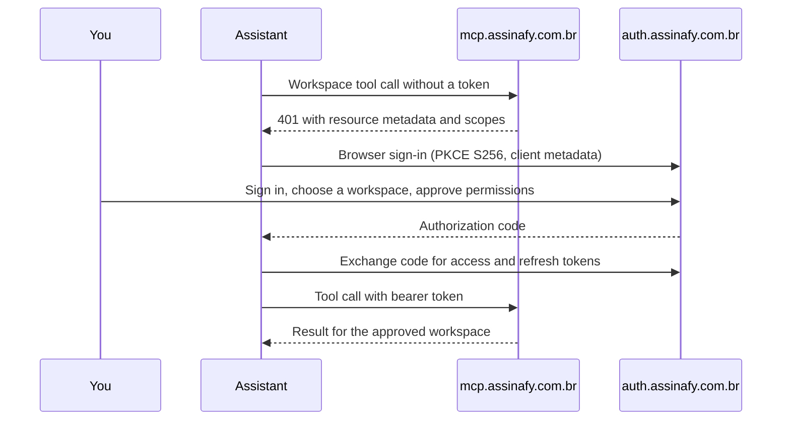
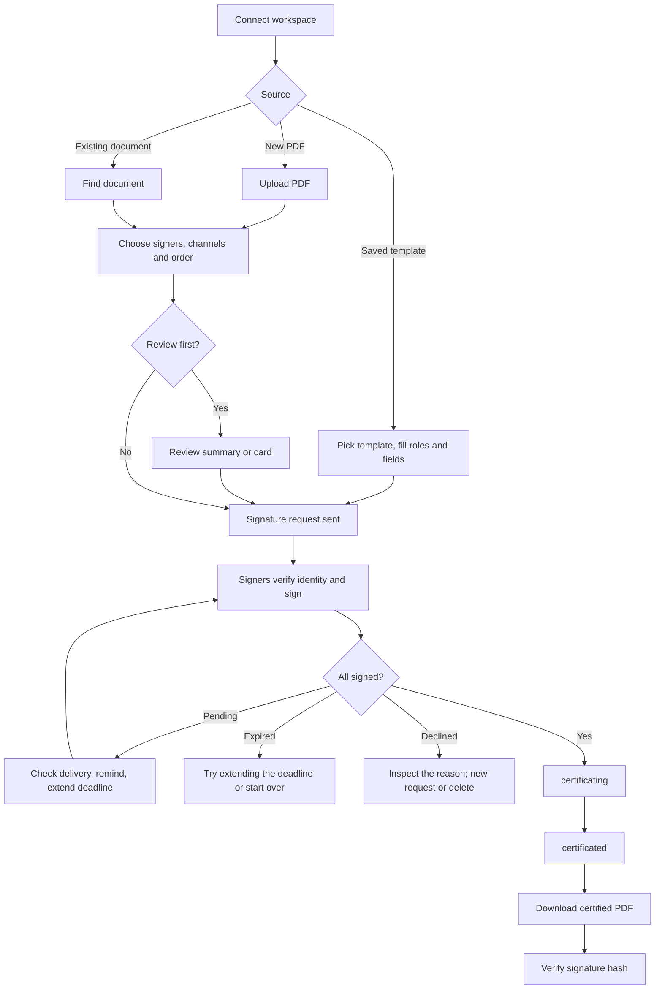

# Assinafy agent plugin

*[Leia em português](README.md) · English*

Send documents for legally valid electronic signature in Brazil without leaving
your AI assistant. Upload a PDF or use a saved template, request signatures by **Email**,
**WhatsApp**, **biometric ID and liveness**, or **ICP-Brasil digital certificate (A1/A3)**, follow progress, remind
signers, download the certified PDF and verify any signature.

This repository is one plugin, and its marketplace, for Claude (Claude Code, the
Claude apps and Cowork), OpenAI Codex and ChatGPT, and VS Code with GitHub Copilot. It
connects your assistant to the hosted
[Assinafy MCP server](https://mcp.assinafy.com.br/mcp) and adds the `signing` skill,
which teaches the assistant the signing flow, channel rules and safe follow-up. You sign in with your Assinafy account through OAuth 2.1. You don't
need an API key, client secret or local server.

- [Install](#install)
- [Sign in](#sign-in)
- [The complete signing flow](#the-complete-signing-flow)
- [What you can ask](#what-you-can-ask)
- [Signature methods and costs](#signature-methods-and-costs)
- [Document statuses](#document-statuses)
- [Tools](#tools)
- [Without the plugin](#without-the-plugin)
- [Troubleshooting](#troubleshooting)
- [Security and privacy](#security-and-privacy)

## Install

### Claude Code (terminal, desktop app, VS Code, JetBrains)

```text
/plugin marketplace add assinafy/agent-plugin
/plugin install assinafy@assinafy
```

`/plugin install` opens the plugin's details; choose an install scope (you, this
repository, or you in this repository only). From a shell, one command adds the
marketplace and installs:

```bash
claude plugin install assinafy --marketplace assinafy/agent-plugin   # Claude Code 2.1.292+
```

In the desktop app's **Code** tab use **+ → Plugins → Add plugin**; in VS Code type
`/plugins`. If Claude Code asks, run `/reload-plugins` to activate. The plugin adds:

| Component | Name |
|---|---|
| MCP server | `assinafy` → `https://mcp.assinafy.com.br/mcp` (Streamable HTTP, OAuth 2.1) |
| Skill | `assinafy:signing`, loaded automatically for signing tasks or with `/assinafy:signing` |

Update with `claude plugin update assinafy@assinafy` (or **Update now** in `/plugin`);
remove with `claude plugin uninstall assinafy@assinafy`. Cloud sessions at
claude.ai/code don't load plugins installed on your machine.

### Claude (web, desktop and mobile chat, and Cowork)

**As a plugin** (skill and connector together): go to **Customize → Plugins → Add →
Add marketplace**, enter `assinafy/agent-plugin` and add **Assinafy**. Then open the
plugin's **Connectors** tab, add the Assinafy connector and click **Connect** to sign in.
The plugin is saved to your account, so it also appears in Cowork and syncs to Claude
Code. On Team and Enterprise plans an Owner may need to allow the source or add the
connector.

**As a connector only** (tools without the skill):

- **Free, Pro and Max**: go to **Customize → Connectors → Add custom connector**, enter
  `https://mcp.assinafy.com.br/mcp`, leave the OAuth client settings empty (or choose
  **Use Claude's published identity**) and click **Add**. Then click **Connect** and
  sign in to Assinafy.
- **Team and Enterprise**: an Owner adds it under **Organization settings → Connectors →
  Add → Custom** with the same URL. Each member then opens **Customize → Connectors**,
  finds Assinafy and clicks **Connect**. If asked for the connector type, choose **Web**.

In these apps, status, review and field-placement results appear as interactive cards.

### Codex

```bash
codex plugin marketplace add assinafy/agent-plugin
codex plugin add assinafy@assinafy
codex mcp login assinafy --scopes account:read,documents:read,documents:write,templates:read,templates:write,offline_access
```

The last command opens the Assinafy sign-in. Codex's IDE extension doesn't load
plugins; there, add the server by URL as described in [Without the plugin](#without-the-plugin).

### ChatGPT

Add a remote MCP connector with the URL `https://mcp.assinafy.com.br/mcp`, choose OAuth,
select CIMD if a registration choice is offered, and leave client credentials empty.
Then connect and sign in to Assinafy. Status, review and field-placement results appear
as interactive cards.

### VS Code with GitHub Copilot

Run **Chat: Install Plugin From Source** from the Command Palette and enter
`https://github.com/assinafy/agent-plugin`, or add the marketplace to your settings:

```json
"chat.plugins.marketplaces": ["assinafy/agent-plugin"]
```

Agent plugins must be enabled (`chat.plugins.enabled`). The Assinafy server starts with
the plugin; complete the browser sign-in when VS Code asks.

## Sign in

Codex, ChatGPT and VS Code sign in as shown in their install steps; the Claude apps
connect from the plugin's **Connectors** tab. In Claude Code, sign in once after
installing: open `/mcp`, select
**plugin:assinafy:assinafy** and follow the sign-in prompt. Claude Code also shows a
startup notice while the server needs authentication. In a terminal without a browser, run
`claude mcp login --no-browser plugin:assinafy:assinafy` and paste the redirect URL.



- **One connection, one workspace.** To use another workspace, choose **Clear
  authentication** in `/mcp` (or run `claude mcp logout plugin:assinafy:assinafy`) and
  sign in again choosing it.
- **Permissions requested**: `account:read`, `documents:read`, `documents:write`,
  `templates:read`, `templates:write` and `offline_access`. You can approve fewer; tools
  that need a missing permission return `403 insufficient_scope` before doing anything.
  Generating a document from a template needs `templates:write`, and validating field
  values needs `documents:write`.
- **Tokens** are stored securely by your assistant and refreshed automatically. With
  `offline_access`, a connection expires only after 30 days without use.
- Signing in is not needed for **verifying a signature hash**.
- Sign-in uses Assinafy production. Use a test workspace for trials.

## The complete signing flow



### 1. Prepare the document

You can start in one of three ways:

- **A new PDF.** Attach it or point the assistant to the file. The assistant reads it and sends the
  bytes; the server never opens paths on your computer. The decoded limit is 25 MiB.
  - Want to send now to people by email? Say so; one call uploads, waits for processing
    and sends (`assinafy_send_pdf_for_signature`).
  - Want to prepare first? The assistant uploads (`assinafy_upload_document`) and
    can rename it before any request exists (`assinafy_rename_document`).
- **A saved template.** The assistant lists templates with their roles and fields
  (`assinafy_list_templates`), matches the values you give to template fields,
  validates them (`assinafy_validate_fields`) and fills each role with a
  person (`assinafy_create_document_from_template`).
- **A document already in Assinafy.** The assistant finds it by name, signer or status
  (`assinafy_list_documents`) and checks it has no request yet.

### 2. Choose signers, channels and order

The assistant finds each person in your workspace contacts (`assinafy_list_signers`) or
creates them (`assinafy_create_signer`). For each signer you choose:

- **How they are notified**: exactly one compatible channel per signer, Email or WhatsApp.
- **How their identity is verified**: Email code, WhatsApp code, ID photos and liveness,
  or an ICP-Brasil digital certificate (A1 or A3). See [Signature methods and costs](#signature-methods-and-costs).
- **Order** (optional): step 1, 2, 3… People on the same step sign in parallel; the next
  step is invited after the previous one finishes. A certificate signer must be alone
  in their step, so with other signers everyone gets a step.
- **Copy receivers** (optional): contacts who get the signed document without signing.

Also optional: an invitation message and an expiry date.

Two signing modes are available:

- **Virtual** (default): the signer signs the whole document; Assinafy adds the
  certificate page.
- **Collect**: signature, initials, date and input fields are placed on specific pages
  for each signer. In the Claude apps and ChatGPT, `assinafy_place_fields` opens a
  visual editor. Elsewhere, the assistant builds the placements from page sizes and field
  IDs.

### 3. Review and send

Before sending, ask for a cost preview through the matching tool with
`estimate_only: true`; see [costs and balances](#signature-methods-and-costs).

Ask the assistant to show the request before sending. `assinafy_review_signature_request`
lists recipients, channels and expiry and sends nothing. In the Claude apps and ChatGPT, the card's
**Send** button sends exactly what you reviewed. Otherwise, confirm in the chat.

Sending (`assinafy_create_assignment`) creates the signature request and notifies the
signers. An explicit instruction such as "send it to Ana" is your confirmation; the assistant
only asks again when a recipient, document or template role is ambiguous. Invitations
can consume your plan's documents and credits.

### 4. What signers do

Each signer, in order:

1. Receives the invitation by the selected Email or WhatsApp channel, with your message.
2. Opens Assinafy's signing page and accepts the terms.
3. Confirms identity:
   - **Email**: types the one-time code sent to their email.
   - **WhatsApp**: types the one-time code sent to their WhatsApp.
   - **Digital certificate**: signs with their own ICP-Brasil certificate, A1 (file) or
     A3 (token or smart card). The certificate must match the CPF or CNPJ registered
     on the signer's contact in Assinafy.
   - **Biometrics**: provides ID photos and a liveness check in Assinafy.
4. Reviews the document, fills any assigned fields, and signs, or declines with a reason.

The assistant cannot sign, accept terms or enter codes for anyone. Signing links and codes are
never shown in the chat.

### 5. Follow progress

- "Has everyone signed?" the assistant finds the document and reports who signed and who is
  pending (`assinafy_get_document`, or the `assinafy_show_document` status
  card with **Remind** and **Refresh**).
- "Did the invitation reach Bruno?" the assistant reads the email delivery history in the
  document's signer records (`assinafy_get_document`) and WhatsApp delivery details
  (`assinafy_list_whatsapp_notifications`).
- "What happened with this document?" the assistant shows the event timeline (`assinafy_list_document_activities`).

### 6. Remind or change the deadline

- **Remind**: The assistant confirms the person is still pending and already invited (their
  step is active), then sends one reminder
  (`assinafy_resend_notification`). Each reminder may use credits; the assistant
  doesn't repeat it just because nothing changed.
- **Extend**: The assistant changes the expiry without notifying anyone
  (`assinafy_set_assignment_expiration`).
- **Fix a contact**: The assistant updates the email, phone or authorized
  government ID (`assinafy_update_signer`).
  Assinafy blocks changing a channel that the signer already verified on an
  unfinished document. Changing an unverified channel invalidates earlier links;
  the assistant sends a reminder afterwards only if you ask.

### 7. Certification

When the last signer finishes, the document moves to `certificating` and then
`certificated`. "100% signed" can still be `certificating`; the assistant waits for
`certificated` before downloading.

If identity verification is `InReview`, the account reviews it in Assinafy. Once
everyone signs, the document waits at `pending_identity_review` until approval;
rejection cancels the document and sends cancellation notices.

If the request expires (`expired`), the assistant can try to extend it (`assinafy_set_assignment_expiration`); if
Assinafy doesn't allow it, start over.
If a signer declines (`rejected_by_signer`), the assistant shows the reason and you decide
whether to delete the document and send a new request.

### 8. Download and verify

- **Download**: The assistant downloads the certified PDF (`assinafy_download_document`,
  `artifact: "certificated"`) and saves it with its file tools. Other artifacts are
  `original`, `certificate-page`, `bundle` and `pades`. Page previews use
  `assinafy_download_document_page`.
- **Verify**: give the assistant the signature hash printed on a signed document.
  `assinafy_verify_document` checks it publicly and returns whether it is valid, the
  status, signer count and completion date. It works without signing in.

### 9. Recover or delete

Composite operations are not transactional and writes are never retried
automatically. If a send fails after the upload, the assistant reports the retained document
and continues from it instead of uploading again. Deleting (`assinafy_delete_document`)
happens only when you ask, and only in a deletable status.

## What you can ask

Names, emails and dates are examples.

| You say | What happens |
|---|---|
| "Send contract.pdf to Ana Lima, ana@example.com, for signature." | Uploads, waits for processing and emails Ana |
| "Upload proposal.pdf but don't send it. Call it Proposal v2." | Uploads and renames; nobody is notified |
| "Send Proposal v2 to Ana first, then Bruno by WhatsApp." | Signing order with Email then WhatsApp verification |
| "Carla signs with her digital certificate." | Checks that Carla's contact has a CPF or CNPJ in Assinafy and requests a certificate signature |
| "Let me review before sending the NDA to Ana and Bruno." | Shows the request; sends only after you confirm |
| "Copy finance@example.com without asking them to sign." | Adds a copy receiver |
| "Use the NDA template for Carla, carla@example.com, company Acme Ltda." | Matches and validates the field, fills the role and sends |
| "Is 11.222.333/0001-81 valid for the CNPJ field?" | Validates without creating anything |
| "Which documents are waiting for signatures?" | Lists `pending_signature` documents |
| "Has everyone signed the Acme agreement?" | Reports who signed and who is pending |
| "Did the WhatsApp invitation to Bruno arrive?" | Shows WhatsApp delivery details |
| "Remind Ana to sign the service agreement." | Confirms she is pending, then sends one reminder |
| "Give the lease signers until 15 December." | Changes the expiry; no reminder |
| "Download the signed copy of the Acme agreement." | Waits for certification, then downloads the certified PDF |
| "Is this signature valid? Hash FE32ED…" | Public verification, no sign-in needed |
| "Delete the draft Proposal v1." | Deletes it if its status allows |

## Signature methods and costs

| Verification | How the signer confirms | Requirements | Credits per signer |
|---|---|---|---|
| Email (default) | Code sent by email | An email address | Included |
| WhatsApp | Code sent by WhatsApp | WhatsApp number in E.164 (`+5511…`), WhatsApp notification, paid plan | 0.45 |
| Digital certificate | ICP-Brasil A1 or A3 certificate | Digital Certificate feature; CPF or CNPJ saved in `government_id`; alone in their step | 0.5 plus the notification |
| Biometrics | ID photos and liveness | ID Document + Face Match feature; valid CPF saved in `government_id` | Use the cost preview |

- Each signature request uses one document from your plan's allowance, or 1 credit once
  the allowance is used up. WhatsApp costs come from its notification.
- A **CPF** signer needs that person's e-CPF, or an e-CNPJ naming them as legal
  representative. A **CNPJ** signer needs that company's e-CNPJ, from any of its
  representatives.
- Save an authorized CPF/CNPJ in the signer contact's `government_id` through a
  create/update contact call or in Assinafy. Biometrics requires a valid CPF;
  certificate signing requires the matching person or company identity.
- Exactly one notification channel per signer: Email verification uses Email;
  WhatsApp verification uses WhatsApp; certificate and biometrics accept either.
  WhatsApp notification is a paid feature.
- When your plan doesn't include WhatsApp or certificate signing, Assinafy refuses the
  request (`403`) and the assistant tells you which feature is missing.
- Sending a PDF in one step (`assinafy_send_pdf_for_signature`) always uses Email. The assistant uses the
  step-by-step flow for other channels, signing order or copy receivers.

Use `estimate_only: true` on the existing PDF, assignment, template or reminder
tool to preview balances, costs and blocking reasons. A PDF preview uploads and
retains its document without contacts or invitations; reuse its ID to send.
Other previews create no records or messages. See
[cost previews and payloads](skills/signing/references/tools.md#cost-previews).

## Document statuses

| Status | Meaning | Can delete |
|---|---|:---:|
| `uploading`, `uploaded`, `metadata_processing` | Being processed | no |
| `metadata_ready` | Ready to prepare or send | yes |
| `pending_signature` | Waiting for signers | yes |
| `pending_identity_review` | All signed; account identity review required | no |
| `certificating` | All signed; certification in progress | no |
| `certificated` | Signed and certified | no |
| `expired` | Request expired | yes |
| `rejected_by_signer`, `rejected_by_user` | Declined | yes |
| `failed` | Processing failed | yes |

## Tools

27 tools, one per operation. Full request and response payloads for every tool are in
[`skills/signing/references/tools.md`](skills/signing/references/tools.md).
Complete schemas and examples are in
[`tool-payloads.json`](skills/signing/references/tool-payloads.json).

| Tool | Effect |
|---|---|
| `assinafy_list_documents` | Read |
| `assinafy_get_document` | Read |
| `assinafy_list_document_activities` | Read |
| `assinafy_list_whatsapp_notifications` | Read |
| `assinafy_show_document` | Read; status card |
| `assinafy_upload_document` | Write; no invitations |
| `assinafy_rename_document` | Write; no invitations |
| `assinafy_send_pdf_for_signature` | Sends invitations |
| `assinafy_create_assignment` | Sends invitations |
| `assinafy_create_document_from_template` | Sends invitations |
| `assinafy_review_signature_request` | Read; review card |
| `assinafy_place_fields` | Read; field editor card |
| `assinafy_resend_notification` | Sends a reminder |
| `assinafy_set_assignment_expiration` | Changes the deadline |
| `assinafy_list_signers` | Read |
| `assinafy_get_signer` | Read |
| `assinafy_create_signer` | Write; no invitations |
| `assinafy_update_signer` | Write; no invitations |
| `assinafy_list_templates` | Read |
| `assinafy_get_template` | Read |
| `assinafy_list_fields` | Read |
| `assinafy_get_field` | Read |
| `assinafy_validate_fields` | Read |
| `assinafy_download_document` | Read |
| `assinafy_download_document_page` | Read |
| `assinafy_verify_document` | Read; public |
| `assinafy_delete_document` | Delete |

Template authoring, webhooks (including signed deliveries and multiple endpoints),
users, API keys and billing are managed in Assinafy or through the
[REST API](https://api.assinafy.com.br/v1/docs). Paid plans support up to three
account webhook endpoints. Enable signing and save the one-time creation secret;
OAuth applications cannot retrieve or rotate it later. Account webhooks are
independent of MCP Events and add no tools to this plugin.

## Without the plugin

Any MCP client that supports remote servers with OAuth can use the server directly with
the same URL and sign-in; you get the tools without the skill.

| Client | Setup |
|---|---|
| Claude Code | `claude mcp add --transport http assinafy https://mcp.assinafy.com.br/mcp`, then `/mcp` |
| Codex (including the IDE extension) | `codex mcp add assinafy --url https://mcp.assinafy.com.br/mcp`, then `codex mcp login assinafy --scopes account:read,documents:read,documents:write,templates:read,templates:write,offline_access` |
| VS Code / GitHub Copilot | Add `{"servers": {"assinafy": {"type": "http", "url": "https://mcp.assinafy.com.br/mcp"}}}` to the MCP configuration and start the server |

## Troubleshooting

To sign in again or switch workspace in each client:

| Client | Reconnect |
|---|---|
| Claude Code | `/mcp` → **plugin:assinafy:assinafy** → **Clear authentication**, then sign in (or `claude mcp logout plugin:assinafy:assinafy`) |
| Claude apps, Cowork | **Customize → Plugins → Assinafy → Connectors**: disconnect and connect |
| Codex | `codex mcp logout assinafy`, then `codex mcp login assinafy --scopes account:read,documents:read,documents:write,templates:read,templates:write,offline_access` |
| ChatGPT, VS Code | Disconnect and reconnect Assinafy in the connector or MCP server settings |

| Symptom | Fix |
|---|---|
| Server needs authentication | Sign in as shown in your client's install steps |
| `403 insufficient_scope` | Reconnect and approve the permissions named in the message; nothing was sent |
| `401` after a period without use | The connection expired; reconnect |
| `503` | Assinafy authorization is temporarily unavailable; try again shortly |
| `403` naming WhatsApp or digital certificate | Your plan doesn't include that feature; use Email or change plan |
| Signed PDF not available | The document is still `certificating`; ask again in a moment |
| Error mentioning a retained document | Ask the assistant to continue with that document instead of uploading again |
| Tools missing in Claude Code | Run `/reload-plugins`, then check the **Errors** tab in `/plugin` |
| Wrong workspace | Reconnect and choose the right workspace when signing in |

## Security and privacy

- Authentication is OAuth 2.1 with PKCE. The assistant identifies itself to Assinafy with its
  client metadata document; there is no shared secret. Your assistant stores the
  tokens securely; they are never placed in prompts or tool arguments.
- The server checks every token with Assinafy and acts only on the workspace and
  permissions you approved. Tool arguments cannot switch workspaces.
- Signing links, verification codes and document bytes are not shown in the chat.
- Revoke access by disconnecting in your client (see [Troubleshooting](#troubleshooting)) or in
  your Assinafy account.
- [Privacy policy](https://www.assinafy.com.br/politica-de-privacidade) ·
  [Terms of use](https://www.assinafy.com.br/termos-de-uso) ·
  [Support](https://www.assinafy.com.br/contato)

## License

[MIT](LICENSE)
