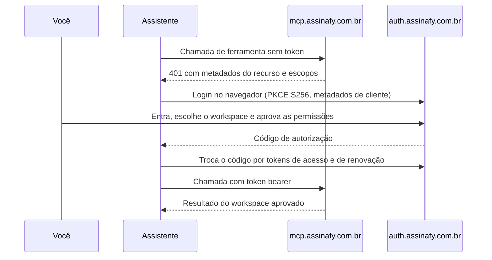
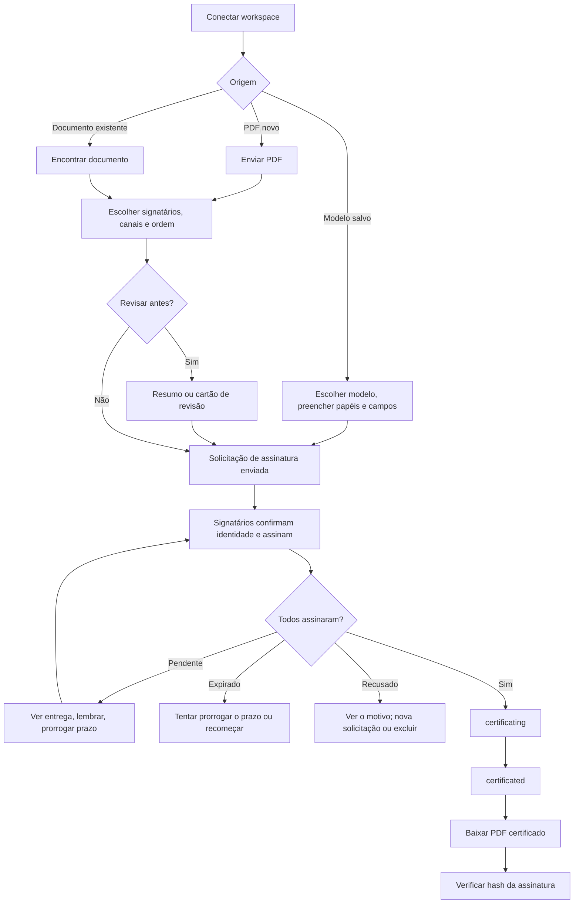

# Plugin da Assinafy para assistentes de IA

*Português · [Read in English](README.en.md)*

Envie documentos para assinatura eletrônica com validade jurídica no Brasil sem sair
do seu assistente de IA. Use um PDF ou um modelo salvo, solicite assinaturas por **e-mail**,
**WhatsApp**, **documento e biometria** ou **certificado digital ICP-Brasil (A1/A3)**, acompanhe o andamento,
lembre os signatários, baixe o PDF certificado e verifique qualquer assinatura.

Este repositório é um plugin, com o seu marketplace, para o Claude (Claude Code, apps
do Claude e Cowork), o OpenAI Codex e o ChatGPT, e o VS Code com GitHub Copilot. Ele
conecta o seu assistente ao [servidor MCP da Assinafy](https://mcp.assinafy.com.br/mcp)
hospedado e adiciona a skill `signing`, que ensina ao assistente o fluxo de assinatura,
as regras de cada canal e o acompanhamento seguro. Você entra com a sua conta Assinafy
por OAuth 2.1. Não é preciso chave de API, segredo de cliente nem servidor local.

- [Instalação](#instalação)
- [Login](#login)
- [Fluxo completo de assinatura](#fluxo-completo-de-assinatura)
- [O que você pode pedir](#o-que-você-pode-pedir)
- [Métodos de assinatura e custos](#métodos-de-assinatura-e-custos)
- [Status do documento](#status-do-documento)
- [Ferramentas](#ferramentas)
- [Sem o plugin](#sem-o-plugin)
- [Solução de problemas](#solução-de-problemas)
- [Segurança e privacidade](#segurança-e-privacidade)

## Instalação

### Claude Code (terminal, app desktop, VS Code, JetBrains)

```text
/plugin marketplace add assinafy/agent-plugin
/plugin install assinafy@assinafy
```

`/plugin install` abre os detalhes do plugin; escolha o escopo da instalação (para
você, para este repositório ou só para você neste repositório). No terminal, um único
comando adiciona o marketplace e instala:

```bash
claude plugin install assinafy --marketplace assinafy/agent-plugin   # Claude Code 2.1.292+
```

Na aba **Code** do app desktop use **+ → Plugins → Add plugin**; no VS Code digite
`/plugins`. Se o Claude Code pedir, rode `/reload-plugins` para ativar. O plugin adiciona:

| Componente | Nome |
|---|---|
| Servidor MCP | `assinafy` → `https://mcp.assinafy.com.br/mcp` (Streamable HTTP, OAuth 2.1) |
| Skill | `assinafy:signing`, carregada automaticamente em tarefas de assinatura ou com `/assinafy:signing` |

Atualize com `claude plugin update assinafy@assinafy` (ou **Update now** em `/plugin`);
remova com `claude plugin uninstall assinafy@assinafy`. Sessões na nuvem em
claude.ai/code não carregam plugins instalados na sua máquina.

### Claude (chat na web, desktop e celular, e Cowork)

**Como plugin** (skill e conector juntos): vá em **Customize → Plugins → Add → Add
marketplace**, informe `assinafy/agent-plugin` e adicione **Assinafy**. Depois abra a
aba **Connectors** do plugin, adicione o conector da Assinafy e clique em **Connect**
para entrar. O plugin fica salvo na sua conta, então também aparece no Cowork e é
sincronizado com o Claude Code. Nos planos Team e Enterprise, um Owner pode precisar
liberar a origem ou adicionar o conector.

**Só como conector** (ferramentas sem a skill):

- **Free, Pro e Max**: vá em **Customize → Connectors → Add custom connector**, informe
  `https://mcp.assinafy.com.br/mcp`, deixe vazias as configurações de cliente OAuth (ou
  escolha **Use Claude's published identity**) e clique em **Add**. Depois clique em
  **Connect** e entre na Assinafy.
- **Team e Enterprise**: um Owner adiciona o conector em **Organization settings →
  Connectors → Add → Custom** com a mesma URL. Cada membro abre **Customize →
  Connectors**, encontra a Assinafy e clica em **Connect**. Se for pedido o tipo de
  conector, escolha **Web**.

Nesses apps, status, revisão e posicionamento de campos aparecem como cartões interativos.

### Codex

```bash
codex plugin marketplace add assinafy/agent-plugin
codex plugin add assinafy@assinafy
codex mcp login assinafy --scopes account:read,documents:read,documents:write,templates:read,templates:write,offline_access
```

O último comando abre o login da Assinafy. A extensão do Codex para IDE não carrega
plugins; nela, adicione o servidor pela URL como em [Sem o plugin](#sem-o-plugin).

### ChatGPT

Instale a [Assinafy pelo diretório de plugins do
ChatGPT](https://chatgpt.com/plugins/plugin_asdk_app_6acbe48b99f881919f32df8e549c1efa),
conecte e entre na Assinafy. Para adicionar só o servidor, adicione um conector MCP
remoto com a URL `https://mcp.assinafy.com.br/mcp`, escolha OAuth, selecione CIMD se for
perguntado o tipo de registro e deixe as credenciais de cliente vazias. Depois conecte e
entre na Assinafy. Status, revisão e posicionamento de campos aparecem como cartões
interativos.

### VS Code com GitHub Copilot

Rode **Chat: Install Plugin From Source** na Command Palette e informe
`https://github.com/assinafy/agent-plugin`, ou adicione o marketplace às configurações:

```json
"chat.plugins.marketplaces": ["assinafy/agent-plugin"]
```

Os plugins de agente precisam estar ativados (`chat.plugins.enabled`). O servidor da
Assinafy inicia com o plugin; faça o login no navegador quando o VS Code pedir.

## Login

Codex, ChatGPT e VS Code fazem o login como indicado na instalação de cada um; os apps
do Claude conectam pela aba **Connectors** do plugin. No Claude Code, faça o login uma
vez depois de instalar: abra `/mcp`, selecione
**plugin:assinafy:assinafy** e siga o pedido de login. O Claude Code também exibe um
aviso ao iniciar enquanto o servidor precisar de autenticação. Em um terminal sem navegador, rode
`claude mcp login --no-browser plugin:assinafy:assinafy` e cole a URL de retorno.



- **Uma conexão, um workspace.** Para usar outro workspace, escolha **Clear
  authentication** em `/mcp` (ou rode `claude mcp logout plugin:assinafy:assinafy`) e
  entre de novo escolhendo-o.
- **Permissões solicitadas**: `account:read`, `documents:read`, `documents:write`,
  `templates:read`, `templates:write` e `offline_access`. Você pode aprovar menos;
  ferramentas que precisem de uma permissão ausente retornam `403 insufficient_scope`
  antes de fazer qualquer coisa. Gerar documento a partir de modelo exige
  `templates:write`, e validar valores de campos exige `documents:write`.
- **Tokens** são armazenados com segurança pelo seu assistente e renovados automaticamente.
  Com `offline_access`, a conexão só expira após 30 dias sem uso.
- **Verificar o hash de uma assinatura** não exige login.
- O login usa o ambiente de produção da Assinafy. Para testes, use um workspace de teste.

## Fluxo completo de assinatura



### 1. Prepare o documento

Há três pontos de partida:

- **Um PDF novo.** Anexe o arquivo ou indique onde ele está. O assistente lê o arquivo e
  envia os bytes; o servidor nunca abre caminhos do seu computador. Limite de 25 MiB
  depois de decodificado.
  - Quer enviar já, por e-mail? Diga isso; uma chamada envia o PDF, aguarda o
    processamento e dispara os convites para no máximo 10 pessoas
    (`assinafy_send_pdf_for_signature`). O prazo total é `max_wait_secs` mais dois minutos.
  - Quer preparar antes? O assistente envia o arquivo (`assinafy_upload_document`) e
    pode renomeá-lo enquanto não houver solicitação (`assinafy_rename_document`).
- **Um modelo salvo.** O assistente lista os modelos com papéis e campos
  (`assinafy_list_templates`), associa os valores informados aos campos, valida-os
  (`assinafy_validate_fields`) e atribui uma pessoa a cada papel
  (`assinafy_create_document_from_template`).
- **Um documento já na Assinafy.** O assistente encontra o documento por nome, signatário
  ou status (`assinafy_list_documents`) e confere que ele ainda não tem
  solicitação.

### 2. Escolha signatários, canais e ordem

O assistente procura cada pessoa nos contatos do workspace (`assinafy_list_signers`) ou a
cadastra (`assinafy_create_signer`). Para cada signatário você define:

- **Como é notificado**: exatamente um canal compatível por signatário, e-mail ou WhatsApp.
- **Como a identidade é verificada**: código por e-mail, código por WhatsApp,
  fotos de identificação e prova de vida ou certificado digital ICP-Brasil (A1 ou A3). Veja
  [Métodos de assinatura e custos](#métodos-de-assinatura-e-custos).
- **Ordem** (opcional): etapa 1, 2, 3… Quem está na mesma etapa assina em paralelo; a
  etapa seguinte é convidada quando a anterior termina. Quem assina com certificado
  precisa estar sozinho na sua etapa; com outros signatários, todos recebem etapa.
- **Destinatários em cópia** (opcional): contatos que recebem o documento assinado sem
  assinar.

Também opcionais: mensagem do convite e data de expiração.

Em um modelo salvo, nome e e-mail informados na chamada servem apenas para assinatura
por Email. WhatsApp, certificado e biometria exigem o ID de um contato existente.
Se um signatário do modelo usar etapa, todos usam; as etapas são contíguas a partir de 1.

Signatários com certificado digital exigem assignment virtual. Assignments `collect`
e templates com campos posicionados são recusados antes da estimativa ou do envio com
`digital_certificate_requires_virtual`.

Há dois modos de assinatura:

- **Virtual** (padrão): o signatário assina o documento inteiro; a Assinafy adiciona a
  página de certificado.
- **Coleta**: campos de assinatura, rubrica, data e preenchimento são posicionados em
  páginas específicas para cada signatário. Nos apps do Claude e no ChatGPT,
  `assinafy_place_fields` abre um editor visual. Nos demais, o assistente monta os
  posicionamentos a partir do tamanho das páginas e dos IDs dos campos.

### 3. Revise e envie

Antes de enviar, peça uma estimativa pela ferramenta correspondente com
`estimate_only: true`; veja [custos e saldos](#métodos-de-assinatura-e-custos).

Peça ao assistente para mostrar a solicitação antes de enviar.
`assinafy_review_signature_request` lista destinatários, canais e prazo e não envia
nada. Nos apps do Claude e no ChatGPT, o botão **Enviar** do cartão envia exatamente o que foi
revisado; nos demais casos, confirme na conversa.

O envio (`assinafy_create_assignment`) cria a solicitação e notifica os signatários.
Uma instrução explícita como "envie para a Ana" já é a sua confirmação; o assistente só
pergunta de novo quando um destinatário, documento ou papel do modelo é ambíguo.
Convites podem consumir documentos e créditos do seu plano.

### 4. O que os signatários fazem

Cada signatário, na sua vez:

1. Recebe o convite pelo canal escolhido, e-mail ou WhatsApp, com a sua mensagem.
2. Abre a página de assinatura da Assinafy e aceita os termos.
3. Confirma a identidade:
   - **E-mail**: digita o código enviado ao e-mail.
   - **WhatsApp**: digita o código enviado ao WhatsApp.
   - **Certificado digital**: assina com o próprio certificado ICP-Brasil, A1 (arquivo)
     ou A3 (token ou cartão). O certificado precisa corresponder ao CPF ou CNPJ
     cadastrado no contato do signatário na Assinafy.
   - **Biometria**: envia as fotos de identificação e conclui a prova de vida na Assinafy.
4. Revisa o documento, preenche os campos atribuídos e assina, ou recusa informando o
   motivo.

O assistente não assina, não aceita termos nem digita códigos por ninguém. Links de
assinatura e códigos nunca aparecem na conversa.

### 5. Acompanhe

- "Todos já assinaram?" O assistente encontra o documento e informa quem assinou e quem
  falta (`assinafy_get_document`, ou o cartão de status de
  `assinafy_show_document`, com **Lembrar** e **Atualizar**).
- "Me avise quando assinarem." No ChatGPT Work, o ChatGPT acompanha o documento e
  avisa quando o status muda ou a cópia assinada fica pronta. Os outros clientes
  consultam o status quando você pede.
- "O convite chegou para o Bruno?" O assistente lê o histórico de entrega por e-mail nos
  dados do signatário no documento (`assinafy_get_document`) e os detalhes de entrega
  por WhatsApp (`assinafy_list_whatsapp_notifications`).
- "O que aconteceu com este documento?" O assistente mostra a linha do tempo de eventos
  (`assinafy_list_document_activities`).

### 6. Lembre ou altere o prazo

- **Lembrar**: o assistente confirma que a pessoa ainda está pendente e já foi convidada (a
  etapa dela está ativa) e envia um lembrete
  (`assinafy_resend_notification`). Cada lembrete pode consumir créditos; o
  assistente não repete só porque nada mudou.
- **Prorrogar**: o assistente altera a expiração sem notificar ninguém
  (`assinafy_set_assignment_expiration`).
- **Corrigir um contato**: o assistente atualiza e-mail, telefone ou documento de
  identificação autorizado (`assinafy_update_signer`).
  A Assinafy bloqueia a troca de um canal que o signatário já verificou em
  um documento não concluído. Trocar um canal não verificado invalida links
  anteriores; o assistente só reenvia o convite se você pedir.

### 7. Certificação

Quando o último signatário termina, o documento passa a `certificating` e depois a
`certificated`. "100% assinado" ainda pode estar em `certificating`; o assistente espera
`certificated` antes de baixar.

Se a verificação estiver em `InReview`, a conta responsável faz a revisão na
Assinafy. Depois de todas as assinaturas, o documento fica em
`pending_identity_review` até a aprovação; a recusa cancela o documento e envia
avisos de cancelamento.

Se a solicitação expirar (`expired`), o assistente pode tentar prorrogar o prazo
(`assinafy_set_assignment_expiration`); se a Assinafy não permitir, recomece. Se um
signatário recusar (`rejected_by_signer`), o assistente mostra o motivo e você decide se exclui o documento e envia uma nova solicitação.

### 8. Baixe e verifique

- **Baixar**: o assistente baixa o PDF certificado (`assinafy_download_document`,
  `artifact: "certificated"`) e o salva com as ferramentas de arquivo. Outros artefatos:
  `original`, `certificate-page`, `bundle` e `pades`. Prévias de página usam
  `assinafy_download_document_page`. O base64 binário fica no resultado estruturado,
  sem ser copiado para o texto.
- **Verificar**: informe ao assistente o hash de assinatura impresso no documento assinado.
  `assinafy_verify_document` consulta a verificação pública e retorna se é válido, o
  status, o número de signatários e a data de conclusão. Funciona sem login.

### 9. Recupere ou exclua

Operações compostas não são transacionais e escritas nunca são repetidas
automaticamente. Se um envio falhar depois do upload, o assistente informa o documento
retido e continua a partir dele, sem enviar o PDF de novo. A exclusão
(`assinafy_delete_document`) só acontece quando você pede, e só em status que permitem.

## O que você pode pedir

Nomes, e-mails e datas são exemplos.

| Você diz | O que acontece |
|---|---|
| "Envie contrato.pdf para Ana Lima, ana@example.com, para assinatura." | Envia o PDF, aguarda o processamento e manda o convite por e-mail |
| "Suba proposta.pdf mas não envie. Chame de Proposta v2." | Envia e renomeia; ninguém é notificado |
| "Envie a Proposta v2 primeiro para a Ana, depois para o Bruno por WhatsApp." | Ordem de assinatura com verificação por e-mail e depois WhatsApp |
| "A Carla assina com certificado digital." | Confere se o contato da Carla tem CPF ou CNPJ na Assinafy e solicita assinatura com certificado |
| "Quero revisar antes de enviar o NDA para Ana e Bruno." | Mostra a solicitação; envia só depois da sua confirmação |
| "Coloque financeiro@example.com em cópia, sem assinar." | Adiciona um destinatário em cópia |
| "Use o modelo de NDA para a Carla, carla@example.com, empresa Acme Ltda." | Associa e valida o campo, preenche o papel e envia |
| "11.222.333/0001-81 é válido para o campo CNPJ?" | Valida sem criar nada |
| "Quais documentos estão aguardando assinatura?" | Lista documentos em `pending_signature` |
| "Todos já assinaram o contrato da Acme?" | Informa quem assinou e quem falta |
| "O convite por WhatsApp chegou para o Bruno?" | Mostra os detalhes de entrega por WhatsApp |
| "Lembre a Ana de assinar o contrato de serviços." | Confirma que ela está pendente e envia um lembrete |
| "Dê prazo até 15 de dezembro para os signatários da locação." | Altera a expiração; nenhum lembrete |
| "Baixe a cópia assinada do contrato da Acme." | Aguarda a certificação e baixa o PDF certificado |
| "Esta assinatura é válida? Hash FE32ED…" | Verificação pública, sem login |
| "Exclua o rascunho Proposta v1." | Exclui se o status permitir |

## Métodos de assinatura e custos

| Verificação | Como o signatário confirma | Requisitos | Créditos por signatário |
|---|---|---|---|
| E-mail (padrão) | Código enviado por e-mail | Um e-mail | Incluído |
| WhatsApp | Código enviado por WhatsApp | Número de WhatsApp em E.164 (`+5511…`), notificação por WhatsApp, plano pago | 0,45 |
| Certificado digital | Certificado ICP-Brasil A1 ou A3 | Assignment virtual; recurso Certificado Digital; CPF ou CNPJ salvo em `government_id`; sozinho na sua etapa | 0,5 mais a notificação |
| Biometria | Fotos de identificação e prova de vida | Recurso ID Document + Face Match; CPF válido salvo em `government_id` | Consulte a estimativa |

- Cada solicitação de assinatura usa um documento da franquia do plano, ou 1 crédito
  quando a franquia acaba. O custo do WhatsApp vem da notificação.
- Um signatário com **CPF** precisa do próprio e-CPF, ou de um e-CNPJ que o indique como
  representante legal. Um signatário com **CNPJ** precisa do e-CNPJ dessa empresa, de
  qualquer um dos representantes.
- Salve um CPF/CNPJ autorizado em `government_id` no contato do signatário por
  criação/atualização de contato ou na Assinafy. Biometria exige CPF válido;
  certificado exige a identidade correspondente à pessoa ou empresa.
- Exatamente um canal de notificação por signatário: verificação por e-mail usa
  e-mail; WhatsApp usa WhatsApp; certificado e biometria aceitam qualquer um deles.
  Notificação por WhatsApp é recurso pago.
- Se o seu plano não inclui WhatsApp ou assinatura com certificado, a Assinafy recusa a
  solicitação (`403`) e o assistente informa qual recurso falta.
- O envio de PDF em um passo (`assinafy_send_pdf_for_signature`) sempre usa e-mail. Para outros canais, ordem de
  assinatura ou cópias, o assistente usa o fluxo passo a passo.

Use `estimate_only: true` nas ferramentas existentes de PDF, assignment, template
ou lembrete para consultar saldos, custos e motivos de bloqueio. A prévia de PDF
envia e preserva o documento, sem contatos nem convites; reutilize seu ID para
solicitar assinaturas. As demais prévias não criam registros nem enviam mensagens.
Veja [prévias e payloads](skills/signing/references/tools.md#cost-previews).

## Status do documento

| Status | Significado | Pode excluir |
|---|---|:---:|
| `uploading`, `uploaded`, `metadata_processing` | Em processamento | não |
| `metadata_ready` | Pronto para preparar ou enviar | sim |
| `pending_signature` | Aguardando signatários | sim |
| `pending_identity_review` | Todos assinaram; revisão de identidade pela conta | não |
| `certificating` | Todos assinaram; certificação em andamento | não |
| `certificated` | Assinado e certificado | não |
| `expired` | Solicitação expirada | sim |
| `rejected_by_signer`, `rejected_by_user` | Recusado | sim |
| `failed` | Falha no processamento | sim |

## Ferramentas

27 ferramentas, uma por operação. As requisições e respostas completas de cada
ferramenta estão em
[`skills/signing/references/tools.md`](skills/signing/references/tools.md).
Os schemas e exemplos completos estão em
[`tool-payloads.json`](skills/signing/references/tool-payloads.json).

| Ferramenta | Efeito |
|---|---|
| `assinafy_list_documents` | Leitura |
| `assinafy_get_document` | Leitura |
| `assinafy_list_document_activities` | Leitura |
| `assinafy_list_whatsapp_notifications` | Leitura |
| `assinafy_show_document` | Leitura; cartão de status |
| `assinafy_upload_document` | Escrita; sem convites |
| `assinafy_rename_document` | Escrita; sem convites |
| `assinafy_send_pdf_for_signature` | Envia convites |
| `assinafy_create_assignment` | Envia convites |
| `assinafy_create_document_from_template` | Envia convites |
| `assinafy_review_signature_request` | Leitura; cartão de revisão |
| `assinafy_place_fields` | Leitura; cartão com editor de campos |
| `assinafy_resend_notification` | Envia um lembrete |
| `assinafy_set_assignment_expiration` | Altera o prazo |
| `assinafy_list_signers` | Leitura |
| `assinafy_get_signer` | Leitura |
| `assinafy_create_signer` | Escrita; sem convites |
| `assinafy_update_signer` | Escrita; sem convites |
| `assinafy_list_templates` | Leitura |
| `assinafy_get_template` | Leitura |
| `assinafy_list_fields` | Leitura |
| `assinafy_get_field` | Leitura |
| `assinafy_validate_fields` | Leitura |
| `assinafy_download_document` | Leitura |
| `assinafy_download_document_page` | Leitura |
| `assinafy_verify_document` | Leitura; pública |
| `assinafy_delete_document` | Exclusão |

Criação de modelos, webhooks (incluindo entregas assinadas e múltiplos endpoints),
usuários, chaves de API e cobrança são gerenciados na Assinafy ou pela
[API REST](https://api.assinafy.com.br/v1/docs). Planos pagos aceitam até três
endpoints de webhook de conta. Habilite a assinatura e salve o segredo retornado
na criação; aplicativos OAuth não podem recuperá-lo nem rotacioná-lo depois.
Webhooks de conta são independentes de MCP Events e não adicionam ferramentas.

## Sem o plugin

Qualquer cliente MCP que aceite servidores remotos com OAuth pode usar o servidor
diretamente, com a mesma URL e o mesmo login; você tem as ferramentas, sem a skill.

| Cliente | Configuração |
|---|---|
| Claude Code | `claude mcp add --transport http assinafy https://mcp.assinafy.com.br/mcp`, depois `/mcp` |
| Codex (incluindo a extensão para IDE) | `codex mcp add assinafy --url https://mcp.assinafy.com.br/mcp`, depois `codex mcp login assinafy --scopes account:read,documents:read,documents:write,templates:read,templates:write,offline_access` |
| VS Code / GitHub Copilot | Adicione `{"servers": {"assinafy": {"type": "http", "url": "https://mcp.assinafy.com.br/mcp"}}}` à configuração MCP e inicie o servidor |

## Solução de problemas

Para entrar de novo ou trocar de workspace em cada cliente:

| Cliente | Reconectar |
|---|---|
| Claude Code | `/mcp` → **plugin:assinafy:assinafy** → **Clear authentication** e entre de novo (ou `claude mcp logout plugin:assinafy:assinafy`) |
| Apps do Claude, Cowork | **Customize → Plugins → Assinafy → Connectors**: desconecte e conecte |
| Codex | `codex mcp logout assinafy`, depois `codex mcp login assinafy --scopes account:read,documents:read,documents:write,templates:read,templates:write,offline_access` |
| ChatGPT, VS Code | Desconecte e conecte a Assinafy nas configurações do conector ou do servidor MCP |

| Sintoma | Solução |
|---|---|
| Servidor pede autenticação | Faça o login como indicado na instalação do seu cliente |
| `403 insufficient_scope` | Reconecte e aprove as permissões citadas na mensagem; nada foi enviado |
| `401` depois de um tempo sem uso | A conexão expirou; reconecte |
| `503` | A autorização da Assinafy está temporariamente indisponível; tente em instantes |
| `403` citando WhatsApp ou certificado digital | O seu plano não inclui o recurso; use e-mail ou mude de plano |
| PDF assinado indisponível | O documento ainda está em `certificating`; peça de novo em instantes |
| Erro citando documento retido | Peça ao assistente para continuar com esse documento em vez de enviar o PDF de novo |
| Ferramentas não aparecem no Claude Code | Rode `/reload-plugins` e confira a aba **Errors** em `/plugin` |
| Workspace errado | Reconecte e escolha o workspace correto no login |

## Segurança e privacidade

- A autenticação é OAuth 2.1 com PKCE. O assistente se identifica para a Assinafy com o seu
  documento de metadados de cliente; não há segredo compartilhado. O seu assistente guarda os
  tokens com segurança; eles nunca vão para prompts ou argumentos de ferramentas.
- O servidor valida cada token com a Assinafy e só age no workspace e nas permissões que
  você aprovou. Argumentos de ferramentas não trocam de workspace.
- Links de assinatura, códigos de verificação e bytes de documentos não aparecem na
  conversa.
- Revogue o acesso desconectando no seu cliente (veja
  [Solução de problemas](#solução-de-problemas)) ou na sua conta Assinafy.
- [Política de privacidade](https://www.assinafy.com.br/politica-de-privacidade) ·
  [Termos de uso](https://www.assinafy.com.br/termos-de-uso) ·
  [Suporte](https://www.assinafy.com.br/contato)

## Licença

[MIT](LICENSE)
